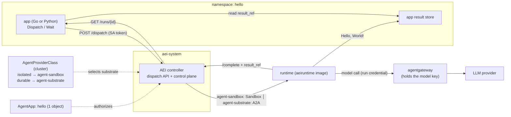

# Hello, World! on AEI — Go and Python

*A concise, end-to-end demonstration: spawn "Hello, World!" as an agentic run that
wraps an LLM conversation, in **either** Go or Python, and read the reply back —
then operationalize it on Kubernetes over agent-sandbox and Agent Substrate (ate),
with agentgateway fronting the model. The point is how little the **app developer**
writes; identity, permissions, and isolation are the platform's job.*

Everything below is real code in this repo. See the "What this maps to" table at
the end for the exact files.

---

## Two personas, and they're independent

| Persona | Writes | Uses |
| --- | --- | --- |
| **App developer** | dispatches a run, reads the result | the app SDK ([`sdks/go`](../sdks/go), [`sdks/python`](../sdks/python)) |
| **Runtime author** | the agent that wraps the LLM | the runtime SDK ([`aeiruntime`](../aeiruntime)) |

The app's language and the runtime's language are **independent** — a Python app
can dispatch a run whose runtime is the Go agent below. The app never imports a
provider or a Kubernetes client; the runtime never imports a provider either. The
two halves meet only at the wire (the dispatch API and the `AEI_*` runtime ABI).

---

## 1. The app — `func main` in both languages

The app does two things: **dispatch** a run and **wait** for it. No per-run
Kubernetes object is created; a run is an HTTP call that returns an id.

### Python

```python
from aei import AeiClient, AgentRunSpec, Identity

client = AeiClient(endpoint="http://aei-controller.aei-system.svc:8080", app="hello")
run_id = client.dispatch(AgentRunSpec(
    task_ref="prompt://hello",
    parameters={"prompt": "Say hello"},
    identity=Identity(subject="user:1", scopes=["model:invoke"]),
    timeout_seconds=60,
))
result = client.wait(run_id)                 # tracks lifecycle only
print(result.phase, result.result_ref)       # Succeeded  store://hello/<run_id>
# reading result_ref from the app's store yields "Hello, World!"
```

### Go

```go
package main

import (
	"context"
	"fmt"
	"time"

	aeiapp "github.com/jackfrancis/agent-execution-interface/sdks/go/aeiapp"
)

func main() {
	c := aeiapp.New("http://aei-controller.aei-system.svc:8080", "hello")
	runID, err := c.Dispatch(context.Background(), aeiapp.Spec{
		TaskRef:        "prompt://hello",
		Parameters:     map[string]string{"prompt": "Say hello"},
		Identity:       aeiapp.Identity{Subject: "user:1", Scopes: []string{"model:invoke"}},
		TimeoutSeconds: 60,
	})
	if err != nil {
		panic(err)
	}
	res, _ := c.Wait(context.Background(), runID, 2*time.Second)
	fmt.Println(res.Phase, res.ResultRef) // Succeeded  store://hello/<run_id>
}
```

That is the **entire** app-developer surface. Both target the same dispatch API;
the bearer defaults to the pod's projected ServiceAccount token.

---

## 2. The runtime — the agent that says hello

A separate image (the "runtime author" persona), built once and reused across
substrates and app languages. The runtime SDK reduces it to: read the run, call
the model, report where the result landed.

```go
package main

import (
	"context"
	"os"

	"github.com/jackfrancis/agent-execution-interface/aeiruntime"
)

func main() {
	// Main decodes the RunSpec and resolves the run credential (redeeming a pull
	// ticket if the substrate uses one), runs fn under the deadline, and reports
	// completion — the whole ABI in one call.
	aeiruntime.Main(os.Getenv, nil, func(ctx context.Context, rt *aeiruntime.Runtime) error {
		prompt := rt.Spec().Parameters["prompt"]

		// Wrap an LLM conversation: reach the model via agentgateway or a vended
		// credential (§3), so no standing model key is on this runtime. (chat/save = app code.)
		reply, err := chat(ctx, rt, prompt) // → "Hello, World!"
		if err != nil {
			return err
		}

		// AEI carries lifecycle, not payload: write the reply to the app's store,
		// then report where it landed. result_ref is an opaque pointer AEI never reads.
		ref := save(rt.Spec().RunID, reply)
		return rt.Complete(ctx, nil, aeiruntime.Timing{}, ref)
	})
}
```

**Receiving output.** AEI standardizes *lifecycle*, not *payload*: the runtime
writes "Hello, World!" to the app's own store and reports a `resultRef`; the app's
`wait()` returns that pointer and the app dereferences it. AEI never sees the
greeting — which is exactly why it works for any payload, model, or store.

---

## 3. Operationalize on Kubernetes — one app, swappable substrates

Two long-lived objects, created once. The app object never changes when the
substrate does.

### The app registration (identical for every substrate)

```yaml
apiVersion: agents.x-k8s.io/v1alpha1
kind: AgentApp
metadata: { name: hello, namespace: hello }
spec:
  providerClassName: isolated
  dispatchers: [hello]            # the ServiceAccount the app Deployment runs as
  identity:
    audience: hello-agent
    maxScopes: [model:invoke]     # the ceiling; a run may request no more
```

`providerClassName` names an **`AgentProviderClass` by name only**. The class is
**cluster-scoped**, so there is no namespace to match and no naming convention
linking the two objects — any `AgentApp`, in any namespace, may name any class
(here `isolated`); an empty value selects the cluster default (annotated
`is-default-class`). The relationship is **N:1 — one app resolves to exactly one
class, never 1:many**: `providerClassName` is a single value the dispatch request
cannot override, while many `AgentApp`s may share one class. An app that needs two
substrates uses **two `AgentApp`s** (or two classes) — a single `AgentApp` cannot
fan out to both.

### The substrate bindings (admin-owned) — both can coexist

Operators name a class for the trait an app cares about (like a `StorageClass` or
`RuntimeClass`), never after the provider — the name is the stable indirection.

**`isolated`** — backed by agent-sandbox: an isolated, single-pod workload per run
(gVisor/Kata):

```yaml
apiVersion: agents.x-k8s.io/v1alpha1
kind: AgentProviderClass
metadata: { name: isolated, annotations: { agents.x-k8s.io/is-default-class: "true" } }
spec:
  provider: agent-sandbox
  parameters:
    namespace: hello
    image: registry.example/hello-runtime:v0     # the aeiruntime agent image (§2)
    serviceAccount: hello-runtime
    controlURL: http://aei-controller.aei-system.svc:8080/aei/v1alpha1
  defaultIsolationClass: gvisor
  capabilities: [ASYNC]
```

**`durable`** — backed by Agent Substrate (ate): a durable, multiplexed,
snapshotted actor; dispatch is an A2A message through the atenet-router, no
workload per run:

```yaml
apiVersion: agents.x-k8s.io/v1alpha1
kind: AgentProviderClass
metadata: { name: durable }        # a non-default class; apps opt in by name
spec:
  provider: agent-substrate
  parameters:
    routerURL: http://atenet-router.ate-system.svc.cluster.local
    actor: aei-runtime            # the standing actor (provisioned out-of-band: `kubectl ate`)
    atespace: aei
    controlURL: http://aei-controller.aei-system.svc:8080/aei/v1alpha1
  capabilities: [ASYNC, PULL_CREDENTIAL, DURABLE]
```

**Both classes coexist; an app names one** (`providerClassName: isolated`, above).
Moving an app to the durable substrate is a one-field edit — either the *app*
re-selects (`providerClassName: durable`) or the *operator* repoints a class's
`spec.provider`. Either way both `func main`s and the runtime image are untouched —
the runtime can't tell which substrate launched it. Note `durable` advertises
`PULL_CREDENTIAL`: because an actor's RAM is snapshotted, AEI mints a single-use
**ticket** instead of a live token, which the runtime redeems before working — the
same runtime code, no change.

### agentgateway — the model egress (optional)

Neither substrate lets the runtime hold a *standing* model key; how it reaches the
model has two composable options (design.md, Contract 3), and **agentgateway is one
of them, not required**:

- **agentgateway** (used above) — an in-cluster AI gateway holds the provider key
  and is the egress point. The runtime calls it authorized by its run credential
  and **never sees the key at all**; the gateway also centralizes egress policy,
  rate limits, and model observability.
- **`vend`, no gateway** — the runtime brokers a short-lived model credential at
  run time (`rt.Vend(ctx, "openai")` → the control plane's `/vend`, backed by an
  app-supplied credential source), holds it in memory for the run only (R2), and
  calls the model provider directly. No extra infrastructure component.

Use whichever fits. For an **isolated/ephemeral** runtime, `vend` is the simplest —
the short-lived key lives only for the run. For the **durable, snapshotted** actor,
prefer agentgateway: a vended key could sit in the actor's RAM at checkpoint time,
whereas the gateway keeps the key off the runtime entirely — the model-credential
analog of why the `durable` class uses a pull-ticket for its run credential.



---

## 4. Identity, permissions, isolation — who owns what

The recurring theme: the **app developer's** column is nearly empty.

| Concern | Owner | What the app developer does |
| --- | --- | --- |
| **Run identity** (per-run credential) | AEI control plane mints it — scoped, short-TTL, audience-bound | nothing (declares `maxScopes` once) |
| **Who may dispatch** | AEI validates the caller's SA token (TokenReview) against `AgentApp.dispatchers` | list the app's ServiceAccount once |
| **Permissions** (least privilege) | AEI enforces `requested ⊆ maxScopes`, mint-time | pass the scopes a run needs |
| **Model credential** | **agentgateway** holds the key, *or* the runtime `vend`s a short-lived one (§3) — never a standing key, either way | nothing |
| **Isolation** | admin's `AgentProviderClass` (`isolationClass` → gVisor/Kata/actor); the provider satisfies it | nothing |
| **Substrate choice** | admin (`AgentProviderClass.provider`) | nothing — the app never names a substrate |
| **Credential at rest** | AEI's pull-ticket for snapshotting substrates; the runtime holds creds in memory only | nothing |

Net: to ship this Hello World, the app developer writes **one `func main`** and
**one `AgentApp`** (a ServiceAccount name + a scope ceiling). Minting, isolation,
substrate selection, and the model key are all handled below the app.

---

## What this maps to (real code today)

| Piece | Where | Status |
| --- | --- | --- |
| Python app SDK | [`sdks/python`](../sdks/python) | ✅ |
| Go app SDK | [`sdks/go`](../sdks/go) | ✅ |
| Runtime SDK (Go) | [`aeiruntime`](../aeiruntime) | ✅ |
| agent-sandbox provider | [`providers/agentsandbox`](../providers/agentsandbox) | ✅ |
| agent-substrate provider | [`providers/substrate`](../providers/substrate) | ✅ |
| Dispatch API + control plane | [`control`](../control), [`controller`](../controller) | ✅ |
| agentgateway | external (an in-cluster AI gateway) | integration point |
| Python **runtime** SDK | — | follow-up (the Go runtime is language-agnostic over the wire) |
| `chat()` / `save()` | app code (LLM client + result store) | app-defined; AEI carries neither |

See [dispatch-plane.md](dispatch-plane.md) for the app→platform wire,
[runtime-abi.md](runtime-abi.md) for the runtime→platform wire, and
[design.md](design.md) for the three contracts.
